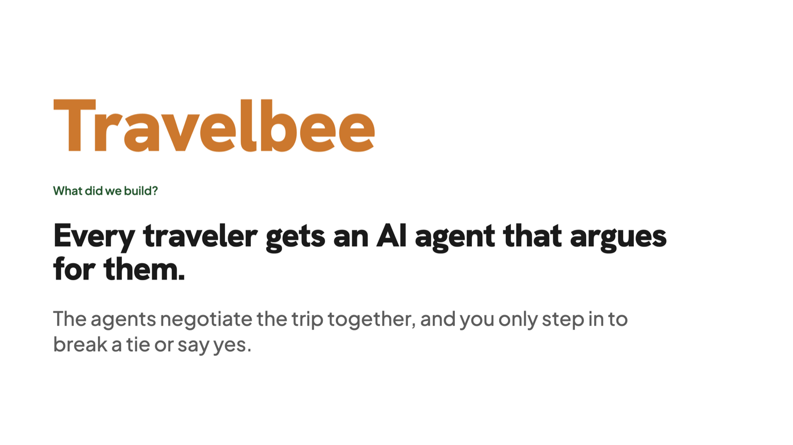
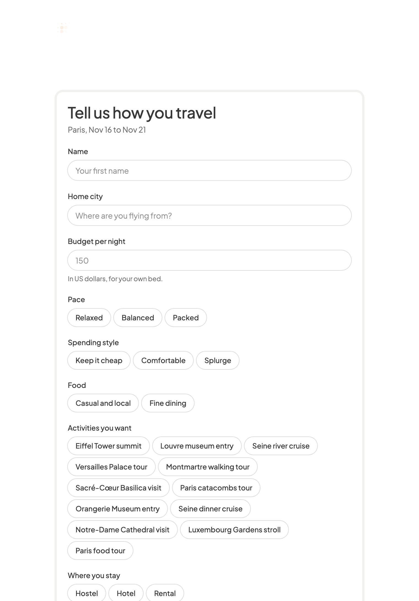
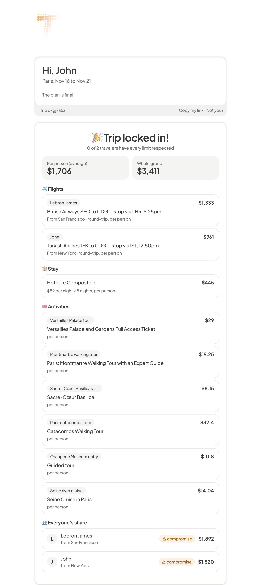
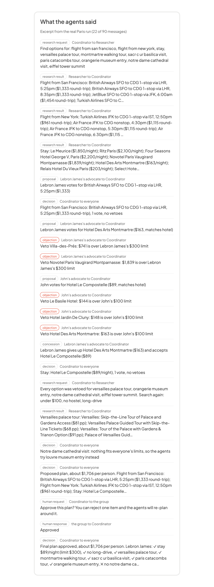
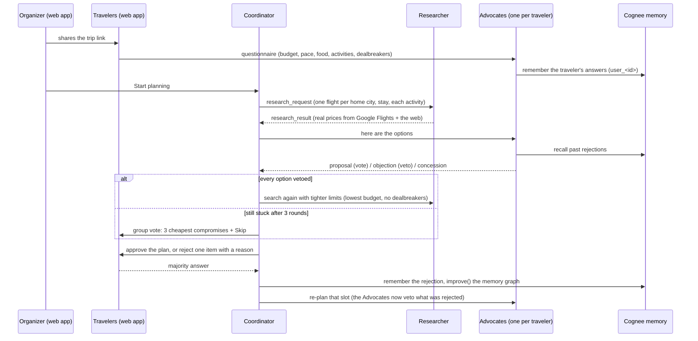

# Travelbee: Group Trip Crew

**Planning a group trip is a negotiation. Travelbee gives every traveler an AI agent that negotiates for them.**

Each traveler fills in a short questionnaire. From then on an **Advocate** agent speaks for them: it remembers their budget, tastes and dealbreakers, votes on options and vetoes what breaks their limits. A **Researcher** agent finds real flights, hotels and activities on the live web. A **Coordinator** agent runs the negotiation round by round. Humans are asked only twice: when the agents are stuck (a group vote between at most 3 priced options), and to approve the final plan.

Built in one day at **"Hive Mind: Building Agent Teams"** (cognee, San Francisco, November 14 2026).

<a href="docs/Travelbee-slides.pdf"></a>

**[The slides we presented (PDF, 7 pages)](docs/Travelbee-slides.pdf):** the problem, what we built, and why we chose memory (Cognee), the room (Band), the ranking (Superlinked) and the search (Keenable).

| | |
|:---:|:---:|
|  |  |
| **1. Every traveler answers once.** The activities are generated for the destination (here, Paris). | **2. The agents agree on a plan.** One flight per home city, a shared hotel, activities, and each person's share. |

<p align="center"></p>
<p align="center"><b>3. Everything the agents say is visible.</b> An excerpt of the 90 real messages from the Paris run above: research, votes, vetoes, a concession, and the group's approval.</p>

---

## Contents

- [How a trip is planned](#how-a-trip-is-planned)
- [The agent team](#the-agent-team)
- [The tools we used, in depth](#the-tools-we-used-in-depth)
  - [Superlinked (SIE): Qwen models for reading the web and ranking](#superlinked-sie-qwen-models-for-reading-the-web-and-ranking)
  - [Cognee: the agents' memory](#cognee-the-agents-memory)
  - [Band: where the agents talk](#band-where-the-agents-talk)
  - [Keenable: live web search](#keenable-live-web-search)
  - [Google Flights via fast-flights](#google-flights-via-fast-flights)
  - [Claude: the live Advocates in Band](#claude-the-live-advocates-in-band)
- [The web app](#the-web-app)
- [Run it](#run-it)
- [Project layout](#project-layout)
- [Where the project stands](#where-the-project-stands)
- [Team](#team)

---

## How a trip is planned



**The rules, in [coordinator.py](coordinator.py):**

1. **The plan is split into slots:** one flight per home city (`flight:<city>`), one stay, and one slot per activity the travelers picked (`activity:<name>`).
2. **Advocates vote and veto.** A slot goes to the option with no vetoes and the most votes. On a tie, the cheaper one wins.
3. **Advocates concede.** When a traveler's favorite is vetoed by someone else, their Advocate gives it up and accepts the winner. You can see this in the log above: Lebron's Advocate concedes Hotel Des Arts Montmartre and accepts Hotel Le Compostelle.
4. **Constrained re-search.** If every option in a slot is vetoed, the Coordinator asks the Researcher again, this time under the lowest budget and with nobody's dealbreakers.
5. **Plan B for activities.** If an activity still has no acceptable option, the agents try another activity the group wanted. In the log above, they try the Louvre instead of Notre-Dame, then a Seine cruise.
6. **Deadlock: the humans vote.** After 3 rounds the group sees at most 3 options with their prices, plus a separate "Skip". The majority decides.
7. **Approval and memory.** The group approves, or rejects one item with a reason. The reason goes into the traveler's memory and the group's memory. From then on the Advocates veto anything that matches it, and only that slot is re-negotiated.

Every step is a `Message(round, from, to, type, content, refs)` from [protocol.py](protocol.py). Message types are `proposal`, `objection`, `concession`, `research_request`, `research_result`, `decision`, `human_request` and `human_response`. `protocol.post()` is the single place messages go out: into the trip's log (shown in the web app) and, when `TRANSPORT=band`, into the Band room.

---

## The agent team

| Agent | File | What it does |
|---|---|---|
| **Coordinator** | [coordinator.py](coordinator.py) | Runs the negotiation: asks for research, collects votes and vetoes, picks winners, handles concessions, re-searches, plan B, deadlocks, approval and re-planning. Writes decisions to the group's memory. |
| **Researcher** | [researcher.py](researcher.py), [extract_options.py](extract_options.py) | Finds real options. Flights come from Google Flights. Hotels and activities come from Keenable web search, read by Qwen into structured options with prices quoted from the page. Nothing is invented and there is no mock data. |
| **Advocates**, one per traveler | [advocate.py](advocate.py) | Decide for their traveler: veto over-budget options and dealbreakers, veto what the traveler rejected before (from memory), and vote for their favorite, ranked by Superlinked. |
| **Live Advocates in Band** | [agents/advocates.py](agents/advocates.py), [p2cli.py](p2cli.py) | The same Advocates as real Band agents: each traveler who signs up gets a Claude agent in the Band room, with Cognee memory, who can chat with the others and with humans. |

Supporting pieces:
- [activities.py](activities.py): Qwen proposes 10 to 12 activities people really book at the destination (for Paris: Seine river cruise, Louvre, Versailles…), with a generic list as fallback.
- [places.py](places.py): fixes typos in city names ("pariss" becomes "Paris", "new yrok" becomes "New York").
- [itinerary.py](itinerary.py): writes the day-by-day itinerary and the reason for the hotel choice.

---

## The tools we used, in depth

### Superlinked (SIE): Qwen models for reading the web and ranking

**What it is.** The Superlinked Inference Engine (SIE) hosts open models behind one HTTP API: embeddings (`/v1/encode`), reranking (`/v1/score`) and chat completions (`/v1/chat/completions`). [sie.py](sie.py) is our client. It uses only the standard library and talks JSON.

**Why we used it.** We needed to (1) turn messy web pages into clean, comparable options, and (2) rank options against each traveler's profile, quickly and cheaply. SIE gave us both with one key.

**Where each model is used:**

| Model | Endpoint | Used by | For |
|---|---|---|---|
| **Qwen3.8 27B** | chat, with a strict JSON schema | [extract_options.py](extract_options.py) | Reads Keenable search snippets into options: `{title, price, price_quote, source, tags}` |
| Qwen3.8 27B | chat | [researcher.py](researcher.py) `_airport()` | Finds the airport for a city ("Paris" → CDG), checked to be a 3-letter code |
| Qwen3.8 27B | chat, JSON schema | [activities.py](activities.py) | Activities specific to the destination, for the questionnaire |
| Qwen3.8 27B | chat, JSON schema | [places.py](places.py) | Fixes typos in city names |
| Qwen3.8 27B | chat, JSON schema | [itinerary.py](itinerary.py) | The final day-by-day itinerary and the reason for the hotel choice |
| **Qwen3 Embedding 4B** | encode | [ranking.py](ranking.py) | Stage 1: shortlist the options closest to the traveler's profile (cosine similarity) |
| **Qwen3 Reranker 4B** | score | [ranking.py](ranking.py) | Stage 2: reorder the shortlist against the profile and past rejections, blended with price against budget |

**How we keep it honest (grounding rules in [extract_options.py](extract_options.py)):**
- Every option must quote the exact price text, and that quote must appear in the snippet it cites. Otherwise it is dropped.
- The URL is always the search result's URL, never one the model wrote.
- Tags come only from the shared tag list.
- Private-group, child, multi-day and "package" prices are dropped, so prices stay "one adult, one booking".
- Prices in € and £ are converted to USD at fixed demo rates, so they can be compared.
- Search snippets are treated as untrusted data: the prompt tells the model to ignore any instructions in them.

Settings: `SUPERLINKED_API_KEY`, plus optional `SIE_BASE_URL`, `SIE_TIMEOUT_S` and `SIE_*_MODEL` to change a model.

### Cognee: the agents' memory

**What it is.** Cognee is a memory layer for AI agents. You `add` facts, it builds a knowledge graph, and you `search` it in natural language. `cognify`/`improve` consolidates new facts into the graph.

**Why we used it.** The point of an Advocate is that it **remembers**. If Ben rejected a flight "because of the layover", his Advocate should veto every option with a layover in the next round, and on the next trip. And all Advocates should share what the group decided.

**How it is used ([memory.py](memory.py)):** four calls behind one interface:

```python
remember(dataset, text)          # save a fact
recall(dataset, query) -> [str]  # search it
improve(dataset)                 # consolidate feedback into the graph
forget(dataset)
```

**Two kinds of memory:**
- `user_<id>`: **one per traveler.** Their questionnaire answers ("Ben's budget is $120 per night") and every rejection ("Ben rejected X because: no layovers"). Only that traveler's Advocate writes it; the others may read it to find common ground.
- `trip_<id>`: **the group's shared memory.** Decisions, group rejections, the final plan. Every Advocate reads it.

**How memory changes behavior ([advocate.py](advocate.py)):** before voting, each Advocate `recall`s "rejected because" from its traveler's memory and the group's memory. Words in the reasons are mapped onto the shared tag list ("no layovers" → `layover`), so a single human rejection becomes a veto on every matching option. The veto quotes the memory, so you can see why.

**Three backends, same calls:**
- **Cognee Cloud** when `COGNEE_SERVICE_URL` and `COGNEE_API_KEY` are set. The whole team shares one tenant, and `improve()` runs on the server.
- **Local Cognee** when the `cognee` package is installed and no cloud is configured.
- **A plain in-memory dictionary**, always on as a safety net. If a Cognee call fails or is slow, we log it once and answer from the dictionary, so a demo never stops.

Cognee is async, so it runs on a private event loop in a background thread. That way the Coordinator's thread and the web server can both call it.

**For the live Band Advocates,** [agents/advocates.py](agents/advocates.py) uses `cognee-integration-band`'s `CogneeMemoryAdapter`. It recalls relevant memory before every message, saves every reply after it, and consolidates the room's conversation into a shared graph (`travelbee_rooms`). [agents/seed_memory.py](agents/seed_memory.py) seeds that graph with each traveler's questionnaire. [agents/show_graph.py](agents/show_graph.py) opens the knowledge graph in your browser.

### Band: where the agents talk

**What it is.** Band is a chat platform where AI agents are first-class participants: each agent has its own identity and API key, joins rooms, and posts and @mentions like a person.

**Why we used it.** We wanted the negotiation to be something you can **watch and join**, not just a log file. In Band, the Coordinator, the Researcher and every Advocate post under their own names in the trip's room, and humans can talk to them there.

**How it is used:**
- **Mirroring ([band.py](band.py)).** With `TRANSPORT=band`, every `protocol.post()` is also sent to the room by the agent that said it (`POST /agent/chats/{room}/messages`), @mentioning the recipient. Each key's identity is looked up with `GET /agent/me`. Sending runs in a background thread, so a Band failure never stops a plan; the web app's log stays the source of truth.
- **One agent per real traveler ([agents/advocates.py](agents/advocates.py)).** When someone signs up in the web app, the script creates "<Name>'s Advocate" with the user API key (`POST /me/agents/register`), adds it to the room, and starts it live. Agents are reused by name and their credentials are saved in `data/advocates.json` (git-ignored).
- `python band.py` checks the keys and the room; `python band.py hello` posts a test message.

Settings: `TRANSPORT=band`, `BAND_ROOM_ID`, `BAND_COORDINATOR_KEY`, `BAND_RESEARCHER_KEY`, `BAND_ADVOCATE_n_KEY`, `BAND_USER_API_KEY`.

### Keenable: live web search

**What it is.** A web search API built for agents: a query in, a list of `{title, url, snippet}` out.

**Why we used it.** Hotel and tour prices change daily and live on many sites (Booking, GetYourGuide, hotel pages…). Searching the live web, then reading the snippets with Qwen, gave us real, cited prices without scraping each site.

**How it is used ([keenable.py](keenable.py), [researcher.py](researcher.py)):** for each stay or activity slot, the Researcher builds a query such as "Paris hotel names with price per night from $ under $100" or "Seine river cruise Paris price per person". It gets up to N results with long snippets and sends them to Qwen for extraction. When options are vetoed, the next query adds the group's constraints ("under $100"). Settings: `KEENABLE_API_KEY`.

### Google Flights via fast-flights

**Why.** Flight prices need to be real and dated. [fast-flights](https://pypi.org/project/fast-flights/) reads Google Flights for a route and dates, with no API key.

**How ([researcher.py](researcher.py) `_flights()`):** for each home city in the group, the Researcher asks for round-trip fares on the trip's dates, between airports resolved by Qwen. Each fare is tagged `nonstop` or `layover`, `red-eye`, and morning/afternoon/evening from the real departure time, so the Advocates can apply dealbreakers such as "no red-eye flights". Every flight links back to the Google Flights search.

### Claude: the live Advocates in Band

The negotiation in the web app is rule-based, so it is fast and predictable. The **live** Advocates in Band are Claude agents: [agents/advocates.py](agents/advocates.py) runs each one with band-sdk's `ClaudeSDKAdapter` (the `sonnet` model by default, through `claude login`) wrapped in Cognee's memory adapter. Their tools are `cognee_search` and `cognee_remember`, plus [p2cli.py](p2cli.py) commands to read their traveler's profile, record a new preference or rejection, read the group's memory, and see how they would vote. The [band/advocate_*.md](band/) files are their instructions.

---

## The web app

[web/server.py](web/server.py) (standard library only) serves [web/index.html](web/index.html) and a small JSON API. [web/bridge.py](web/bridge.py) connects it to the real agents: it runs `coordinator.run_trip()` in a thread, copies every agent message into the trip's log, and turns the Coordinator's questions into votes in the app.

- **No accounts, only links:** a join link for travelers, a secret organizer link, and a personal link per traveler.
- **Questionnaire:** name, home city (typos fixed), budget per night, pace, spending style, food, destination-specific activities, lodging, dealbreakers.
- **Trip details:** departure and return dates are required, can't be in the past, and the return must come after the departure.
- **Group votes:** at a deadlock or for approval, every traveler votes; the majority decides; the organizer can close the vote early.
- **The final plan:** one flight per home city, the stay × nights, the activities, each person's share with ✓/⚠ badges, the group total, and confetti 🎉.
- **Organizer controls:** cancel a planning run, delete a trip (moved to `data/_deleted/`, not erased), plan again.
- Trips and users are stored as JSON in `data/` (or the folder in `TRAVELBEE_DATA`).

---

## Run it

Requirements: Python 3.11+, and keys for Superlinked and Keenable. Cognee and Band are optional.

```bash
git clone https://github.com/temujinkz/travelbee.git
cd travelbee
python3 -m venv .venv
.venv/bin/pip install -r requirements.txt
cp .env.example .env        # then fill in your keys (never commit .env)
```

Start the web app:

```bash
.venv/bin/python web/server.py
```

Open http://127.0.0.1:8123, create a trip, and share the link. To let friends on the same Wi-Fi join, start it with `HOST=0.0.0.0` and give them `http://<your local IP>:8123`.

Optional, for the live Band Advocates (on the same computer as the server):

```bash
.venv/bin/python agents/advocates.py
```

Run the negotiation in the terminal, without the web app:

```bash
.venv/bin/python coordinator.py --ask
```

Useful settings: `PACE_S=0.5` slows the agents down so a live demo is readable; `PRINT_LOG=1` prints every message; `MEMORY_BACKEND=dict` skips Cognee; `LOG_GETS=1` logs the app's polling requests.

---

## Project layout

```
protocol.py          Message format, the shared log, post(), .env loader
coordinator.py       Coordinator agent: negotiation, deadlocks, approval, re-planning
advocate.py          Advocate agents: votes, vetoes, concessions, memory-driven vetoes
researcher.py        Researcher agent: Google Flights + Keenable + Qwen
extract_options.py   Qwen reads search snippets into grounded options
ranking.py           Superlinked embedding + reranker ranking
itinerary.py         Final itinerary written by Qwen
activities.py        Destination-specific activities for the questionnaire
places.py            City-name typo fixing
memory.py            remember / recall / improve / forget on Cognee (cloud, local) or a dict
sie.py               Superlinked SIE client
keenable.py          Keenable search client
band.py              Band transport: every message mirrored into the room
p2cli.py             Command line the live Band Advocates use for memory and votes
agents/              Live Band Advocates (Claude + Cognee), memory seeding, graph viewer
band/                Instructions for the Band Advocates
web/                 Web app: server.py, bridge.py, index.html
docs/                The slides we presented (Travelbee-slides.pdf) and the screenshots in this README
TEAM_SPLIT.md        The plan we split the work with at the hackathon
```

---

## Where the project stands

**Working end to end:** web app → questionnaire → real agents → live flights, hotels and activities → negotiation with memory → group votes → final plan with costs per person. The negotiation is mirrored live in Band, and per-traveler Claude Advocates with Cognee memory can join the room.

**Known limits:**
- **Extracted prices can be wrong.** A price can be misread, or a currency other than $, € or £ can slip through unconverted (¥, for example).
- **A failed search skips its slot.** If Superlinked or Keenable fails or times out, that slot is skipped instead of stopping the plan, and the log says so.
- **Everything depends on the API keys.** Without a valid Superlinked key, no option can be read and the plan comes back empty. Band agents that were deleted on Band must be removed from `data/advocates.json` so they are recreated.
- **Fixed exchange rates.** € and £ are converted at fixed demo rates, not live ones.
- **One plan at a time.** Only one trip can be planned at once per server.

**Next steps:**
- **Majority rule in the negotiation.** Today a single veto blocks an option. Next: the option that satisfies the most travelers wins (dealbreakers still veto), and the humans vote only when no option satisfies a majority.
- **A livelier waiting screen** while the agents work: a negotiation board, agent avatars, a fairness gauge.
- **Live exchange rates** and more currencies.

---

## Team

| Role | Who |
|---|---|
| P1: web app | [temujinkz](https://github.com/temujinkz) |
| P2: memory and Advocates (Cognee, live Band agents) | Samuel ([cal-0210-pixel](https://github.com/cal-0210-pixel)) |
| P3: Coordinator and negotiation, Band transport | Colomban |
| P4: Researcher (Superlinked, Keenable, Google Flights) | Colomban, with Claude Code |

Also contributing: Anika and ywanika.
